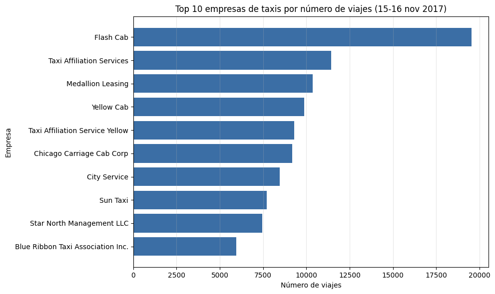
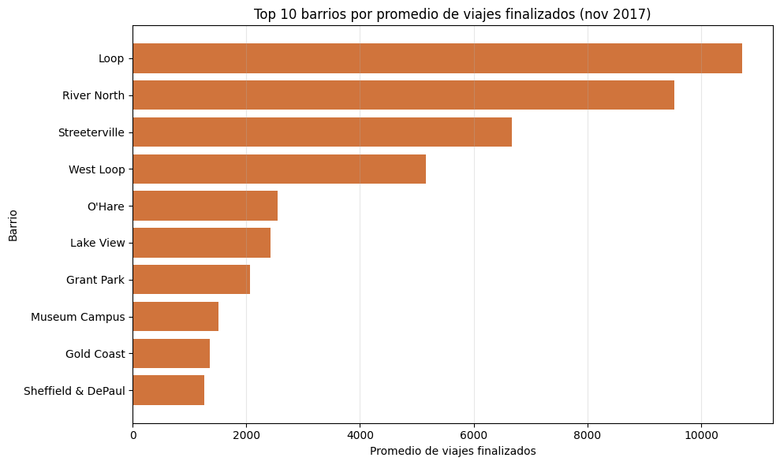
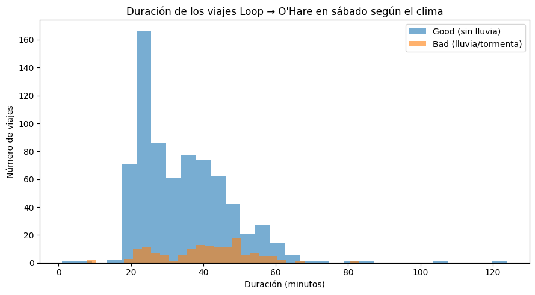

# Viajes en taxi en Chicago: competencia, destinos y efecto del clima

*Proyecto de Bootcamp – TripleTen (Sprint 8). Zuber es una empresa simulada; los datos son de taxis de Chicago de noviembre de 2017, preparados por TripleTen.*

## Problema
Una nueva empresa de viajes compartidos (Zuber) se lanza en Chicago y necesita entender tres cosas: quiénes son sus competidores, adónde viajan los pasajeros y si el clima cambia la duración de los viajes. En concreto: **¿los viajes del Loop al aeropuerto O'Hare duran más los sábados con lluvia?**

## Hallazgos principales
| Pregunta | Hallazgo |
|---|---|
| **Competencia** | Mercado concentrado. Flash Cab (≈19.600 viajes en 2 días) casi duplica a la segunda empresa; las 10 primeras (de 64) concentran el **72,3 %** de los viajes |
| **Destinos** | Loop (≈10.700), River North (≈9.500), Streeterville (≈6.700) y West Loop (≈5.200). Los 10 barrios principales (de 94) concentran el **76,7 %** de las finalizaciones |
| **Clima** | Con lluvia o tormenta, el viaje Loop → O'Hare en sábado dura **≈40,2 min frente a ≈34,2 min** (≈6 min, ≈18 % más). Prueba t: p ≈ 1,54×10⁻⁷ → la diferencia es significativa |

**Recomendación:** concentrar conductores en el centro y en la ruta al aeropuerto; en días de lluvia, ajustar los tiempos estimados de llegada, las tarifas y la oferta de conductores.





## Qué hice
1. **Web scraping:** extraje con `requests` y `BeautifulSoup` la tabla del clima en Chicago de noviembre de 2017 ([fuente](https://practicum-content.s3.us-west-1.amazonaws.com/data-analyst-eng/moved_chicago_weather_2017.html)). Este paso se hizo en un ejercicio de la plataforma de TripleTen.
2. **SQL** ([`sql/zuber_queries.sql`](sql/zuber_queries.sql)): consulté 4 tablas (`trips`, `cabs`, `neighborhoods`, `weather_records`) con `JOIN` (incluido uno por fecha y hora), `CASE`, `GROUP BY`, `LIKE` y filtros por fecha, para obtener los viajes por empresa, los destinos y los viajes Loop → O'Hare con su clima.
3. **Limpieza** con pandas: convertí las fechas y eliminé 197 registros duplicados y 6 viajes de 0 segundos (1.068 → 865 viajes).
4. **Análisis exploratorio** con gráficos de las empresas y los barrios principales, y cálculo de la concentración del mercado.
5. **Prueba de hipótesis** (α = 0,05): prueba de Levene para comparar varianzas (p ≈ 0,82, iguales) y prueba t de Student para dos muestras independientes.

## Herramientas
SQL (PostgreSQL) · Python · pandas · matplotlib · SciPy · requests · BeautifulSoup · Jupyter

## Limitaciones
Hay pocos viajes con lluvia (148 frente a 717 con buen tiempo) y los datos cubren solo 4 sábados de un mes. La hora del día puede influir en la duración (por el tráfico) y no se controló en la prueba.

## Estructura del repositorio
```
.
├── README.md
├── chicago_taxi_analysis.ipynb   # Limpieza, análisis exploratorio y prueba de hipótesis
├── sql/
│   └── zuber_queries.sql         # Consultas SQL del proyecto
├── data/                         # Resultados de las consultas (CSV)
├── images/                       # Gráficos usados en este README
└── requirements.txt
```

## Cómo ejecutarlo
```bash
python -m venv venv
source venv/bin/activate   # En Windows: venv\Scripts\activate
pip install -r requirements.txt
jupyter notebook chicago_taxi_analysis.ipynb
```
